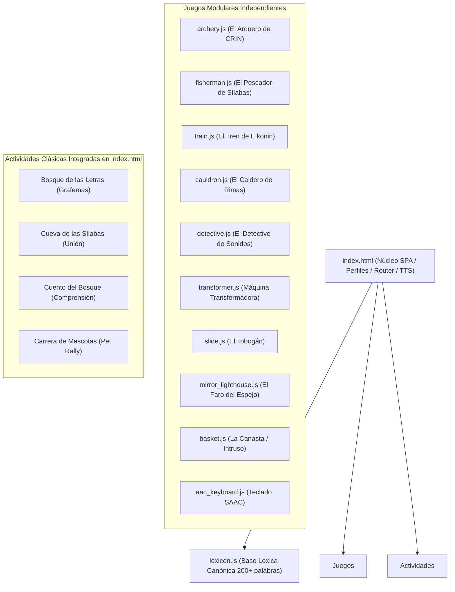

# 📚 Informe Técnico y Arquitectura Completa: CRIN Aventuras de Lectoescritura

> [!NOTE]
> Este documento contiene la radiografía estructural completa de la plataforma, el flujo del motor de voz, el diccionario léxico, el sistema de perfiles y la arquitectura de cada juego. Está diseñado como guía de referencia técnica para alimentar a otras IAs o desarrolladores y generar prompts exactos y quirúrgicos.

---

## 1. 🏗️ Arquitectura General del Sistema

La aplicación es una **Single Page Application (SPA)** de alto rendimiento para niños y terapeutas, construida en **Vanilla JavaScript nativo (ES6+)**, sin frameworks pesados, con renderizado visual acelerado por hardware mediante **HTML5 Canvas 2D**, síntesis de sonido procedural con **Web Audio API** y narración prosódica pedagógica.



### Tecnologías Clave:
- **Frontend Core:** HTML5, CSS3 móvil responsivo con soporte seguro de notch/fullscreen.
- **Gráficos de Juegos:** Canvas 2D (`requestAnimationFrame` con doble búfer en background para 60 FPS estables en tablets).
- **Persistencia:** `localStorage` (sin base de datos externa obligatoria; almacena alumnos, tareas semanales, monedas, estrellas, audios grabados y configuraciones del terapeuta).
- **Despliegue y Hosting:** GitHub Pages en rama `main` con sistema automático de cache-busting `?v=XXX&_nocache=...`.

---

## 2. 🎙️ Arquitectura del Motor de Voz y Sonido

El motor de locución es centralizado y reside en [`index.html`](file:///C:/Users/VIVI/.gemini/antigravity/scratch/crin-aventuras-lecto/index.html). Cualquier juego invoca la función global `speakText(text, callback)`.

### Flujo de Ejecución de `speakText`:
1. **Desbloqueo Obligatorio (`unlockAudioSystem()`):**
   - En navegadores móviles (Chrome/Safari), el audio está bloqueado hasta que el usuario interactúa. Esta función reanuda el `AudioContext` y prepara el canal de voz.
2. **Prioridad 1: Google TTS Natural (Voz Femenina Infantil Dulce):**
   - URL: `https://translate.google.com/translate_tts?ie=UTF-8&q=...&tl=es&client=tw-ob`
   - Se reproduce mediante un elemento `Audio` HTML5 con `playbackRate = 0.96`.
   - Tiene un **Watchdog de Red (1.1s)**: Si la conexión a internet es lenta, falla el DNS o Google bloquea temporalmente por exceso de peticiones, salta inmediatamente a la Prioridad 2 sin dejar al niño esperando en silencio.
3. **Prioridad 2: WebSpeech API (`window.speechSynthesis`):**
   - Respaldo nativo offline del dispositivo.
   - **Por qué puede sonar una voz masculina:** Si el dispositivo local (Windows/Android) tiene configurada como voz predeterminada del sistema a *Microsoft Raúl*, *David* o *Google Español Masculino*, `speechSynthesis` usa esa voz salvo que el selector de voz del terapeuta haya fijado explícitamente *Sabina*, *Helena*, *Paulina* o *Google español (femenina)*.
4. **Filtro de Sílabas y Letras Aisladas:**
   - Si se envía una sílaba como `"PA"`, el motor usa entonación fonética clara para que no se escuche cortada.

---

## 3. 📖 Base Léxica Canónica: `lexicon.js`

Contiene el diccionario `CANONICAL_WORD_LEXICON` con más de 200 entradas pedagógicas graduadas. Cada palabra posee la siguiente estructura de datos:

```javascript
CANONICAL_WORD_LEXICON['ZAPATO'] = {
  escritura: 'ZAPATO',              // Grafía en mayúscula canónica
  pronunciacion: 'Zapato',          // Texto prosódico fonético para el TTS
  letras: ['Z', 'A', 'P', 'A', 'T', 'O'], // Segmentación grafémica
  silabas: ['ZA', 'PA', 'TO'],      // Segmentación silábica
  emoji: 'assets/zapato.png',       // Ruta a PNG de alta resolución o Emoji Unicode
  tipo: 'sustantivo'
};
```

### Funciones de Acceso Global:
- `getCanonicalWord(wordText)`: Normaliza mayúsculas, tildes y sinónimos para devolver el objeto canónico exacto.
- `getLetterType(letter)`: Clasifica en vocal (`vowel`) o consonante (`consonant`) para la colorimetría Montessori (rojo vocales, azul consonantes).

---

## 4. 🎮 Detalle Estructural de Todos los Juegos

### 1. El Arquero de CRIN (`archery.js`)
* **Pantalla:** `#screen-archery` | **Objeto:** `window.ArcheryGame`
* **Mecánica:** Diana balística en perspectiva 3D. El niño apunta tocando palabras u objetivos móviles que flotan a diferentes profundidades y suelta una flecha.
* **Funciones Clave:**
  - `window.openArcheryQuestScreen(mode)`: Inicia el juego en modo tarea (`'task'`) o aleatorio (`'random'`).
  - `window.setArcheryPet(petEmoji)`: Define el avatar arquero (*Unicornio, Zorro, Conejo, Perro*) y lanza la partida.
  - `window.toggleArcheryGameMode()`: Alterna entre Modo Tarea y Modo Aleatorio.
  - `speakCurrentArcheryMission()`: Narra *"Apunta a: ... [PALABRA]"*.

---

### 2. El Pescador de Sílabas (`fisherman.js`)
* **Pantalla:** `#screen-fisherman` | **Objeto:** `window.FishermanGame`
* **Mecánica:** Muelle de madera con héroe pescador. Peces de colores nadan en un río con carteles de sílabas. El niño pesca las sílabas en orden secuencial para armar la palabra en su balde.
* **Estructura Interna:**
  - `FishermanGame.fishes`: Array de peces generados aleatoriamente (`createFishObject`).
  - `FishermanGame.rod`: Cinemática de la caña (lanzamiento balístico `isCasting`, captura `isHooked`, recogida curva al balde `isRetracting`).
  - `FishermanGame.currentSyllableTargetIndex`: Puntero a la sílaba activa.
* **Funciones Clave:**
  - `window.openFishermanQuestScreen(mode)`: Abre pantalla y modal de avatar pescador.
  - `window.setFishermanPet(pet)`: Asigna el avatar pescador en muelle.
  - `window.speakCurrentFishermanMission()`: Anuncia la palabra y la sílaba objetivo.
  - `handleFishSelected(fish)`: Evalúa acierto/error con retroalimentación fonológica y sonora.

---

### 3. El Tren de los Sonidos - Cajas de Elkonin (`train.js`)
* **Pantalla:** `#screen-train` | **Objeto:** `window.TrainGame`
* **Mecánica:** Locomotora de vapor que arrastra vagones vacíos (cajas de Elkonin). En el cielo flotan globos con letras fonéticas. El niño debe colocar los fonemas en el vagón correspondiente.
* **Funciones Clave:**
  - `window.openTrainQuestScreen()`: Inicializa el tren y genera vagones según la longitud de la palabra.
  - `window.speakCurrentTrainMission()`: Locución de la consigna de armado.
  - `handleBalloonSelected(balloon)`: Traslada el globo al vagón con animación parabólica.
  - `handleTrainCompleted()`: Salida triunfal del tren con silbato de vapor y humo.

---

### 4. El Caldero Mágico de las Rimas (`cauldron.js`)
* **Pantalla:** `#screen-cauldron` | **Objeto:** `window.CauldronGame`
* **Mecánica:** Olla de alquimia burbujeante con fuego y vapor. Se presenta una palabra base (ej: *Ratón*) y flotan ingredientes mágicos. El niño debe arrastrar o tocar el ingrediente que rima (ej: *Botón*).
* **Funciones Clave:**
  - `window.openCauldronQuestScreen()`: Carga pociones con palabras rimadas (`generateDynamicRhymePotions`).
  - `window.speakCauldronMission()`: Pide encontrar la rima.
  - `handleIngredientDropped(ingredient)`: Explosión de colores mágica al acertar o boing si no rima.

---

### 5. El Detective de Sonidos Gemelos (`detective.js`)
* **Pantalla:** `#screen-detective` | **Objeto:** `window.DetectiveGame`
* **Mecánica:** Tablero de pistas policiales con lupa. Busca trabajar la **aliteración** (palabras que empiezan con el mismo sonido o sílaba inicial que el sospechoso principal).
* **Funciones Clave:**
  - `window.openDetectiveQuestScreen()`: Despliega expediente y sospechosos.
  - `window.speakCurrentDetectiveClue()`: Narra el sonido sospechoso que se busca.
  - `handleCardSelected(card)`: Destello fotográfico y captura del sospechoso.

---

### 6. La Máquina Transformadora de Palabras (`transformer.js`)
* **Pantalla:** `#screen-transformer` | **Objeto:** `window.TransformerGame`
* **Mecánica:** Manipulación fonémica avanzada (sustitución, adición o sustracción de letras para transformar una palabra en otra: ej: *GATO -> PATO* cambiando solo la primera letra).
* **Funciones Clave:**
  - `window.openTransformerScreen()`: Abre la máquina de vapor con engranajes interactivos.
  - `window.speakTransformerMission()`: Explica la transformación requerida.

---

### 7. El Tobogán de Letras y Sílabas (`slide.js`)
* **Pantalla:** `#screen-slide` | **Objeto:** `window.SlideGame`
* **Mecánica:** Fusión fonológica. Los sonidos bajan por un tobogán o suben en un cohete de estrellas para unirse en una sola palabra sintetizada.
* **Funciones Clave:**
  - `window.openSlideScreen()`: Carga el tobogán y activa las estrellas sonoras.

---

### 8. El Faro del Espejo (`mirror_lighthouse.js`)
* **Pantalla:** `#screen-mirror` | **Objeto:** `window.MirrorGame`
* **Mecánica:** Discriminación visual y auditiva de letras de grafía espejo que confunden a niños con dislexia (**b, d, p, q**). Barcos iluminados por el haz de luz de un faro.
* **Funciones Clave:**
  - `window.openMirrorScreen()`: Orienta la luz del faro hacia el barco con la letra correcta.

---

### 9. La Canasta del Intruso Semántico (`basket.js`)
* **Pantalla:** `#screen-basket` | **Objeto:** `window.BasketGame`
* **Mecánica:** Conciencia semántica y categorización. Se presentan tarjetas de una categoría (ej: *Frutas*) y una intrusa (ej: *Auto*). El niño debe encestar al intruso en la canasta.
* **Funciones Clave:**
  - `window.openBasketScreen()`: Carga canasta y tarjetas de la categoría.

---

### 10. Actividades Clásicas Integradas (`index.html`)
Operan directamente sobre el contenedor `#screen-game` mediante la función `startQuest(mode)`:
- **`mode === 'letter'` (Bosque de las Letras):** Selección de grafemas/fonemas con código de color Montessori para deletrear la palabra.
- **`mode === 'syllable'` (Cueva de las Sílabas):** Unir piedras con sílabas en el orden exacto.
- **`mode === 'story'` (Cuento del Bosque):** Narración ilustrada de 3 escenas con rompecabezas de comprensión lectora.
- **`screen-pet-rally` (Carrera de Mascotas):** Tablero de carrera estilo rally donde el niño avanza casilleros identificando palabras que contienen la letra de su mascota.

---

## 5. 👥 Sistema de Perfiles y Almacenamiento

El estado del alumno activo se gestiona en la variable global `activeChildProfile` y se sincroniza con `localStorage`:

```javascript
activeChildProfile = {
  id: 'uuid_o_nombre',
  firstName: 'Juan',
  lastName: 'Pérez',
  coins: 150,                     // Monedas acumuladas
  stars: 24,                      // Estrellas de victoria
  activePet: '🦄',                // Mascota activa (Unicornio, Perro, Conejo, Zorro)
  avatar: '🧑‍🚀',                 // Traje de astronauta/héroe
  taskWords: ['PATO', 'CASA', 'LIMA'], // Palabras asignadas por el terapeuta
  completedQuests: ['story', 'archery']
};
```

---

## 6. 💡 Cómo Usar este Documento para tus Prompts

Cuando le pidas a otra IA que te redacte instrucciones para este proyecto, puedes indicarle:
1. **El nombre del juego y archivo exacto** (ej: *"Trabajar sobre `train.js` / `#screen-train`"*).
2. **La referencia de voz requerida** (*"Invocar `speakText` con fallback inmediato y watchdog"*).
3. **La regla de toque libre** (*"No bloquear el listener de toque con `isSpeaking`"*).
4. **La versión objetivo** (las versiones se incrementan correlativamente en `CURRENT_APP_VERSION = 'vXXX'` en `index.html` para el cache-busting de GitHub Pages).
